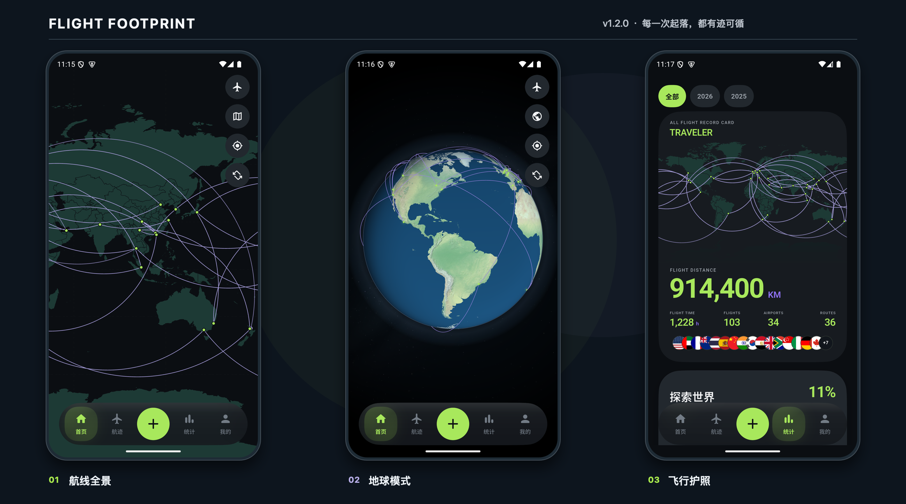

# 航迹 · Flight Footprint

一个独立、本地优先的 Flutter 飞行记录应用。Android 最新版为 `1.5.0`；记录保存在设备内，无需登录。详细底图、可选云同步及版本检查需要联网，核心记录功能可离线使用。



*Android 模拟器实拍 · 深色主题 · 上图为 v1.2.0 历史展示，不代表 v1.5.0 最新界面*

## 主要功能

- 飞行地图与旅行足迹切换；首页默认详细平面地图，支持缩放、拖动、点选和定位，首页与横向全屏地图显示航线方向箭头；地球模式支持真实昼夜、旋转与航线动画
- 旅行足迹按国家 / 地区与中国行政区统计；详细地图点亮已到访板块，地球模式显示足迹点；往返航线以左右分开的弧线示意，真实轨迹保留原样
- 航班记录支持年份筛选、搜索、编辑、删除，以及机场和航班信息自动补全；录入与展示按机场时区处理本地时间
- 统计总里程、飞行时间、航班、机场、航线、机型、航司、城市与国家 / 地区，并生成可保存或分享的飞行护照卡
- 已解锁机型配有16张专属插画、12张家族正侧面代表图和1张旧通用参考图；支持循环透视卡组与翻转展开详情，家族图不代表每个子型号的精确外观
- 城市及国家／地区统计同时纳入已完成航班与保存足迹；航司／城市排行支持胶囊增长与次数跟随，国家统计采用圆形旗帜矩阵
- 探索详情提供常住城市设置、最远足迹纪念卡与解锁大洲；新增四张可循环滑动的飞行记忆卡，展示新抵达城市、最常飞航线及首次记录机型。估算距离不等同于实际飞行里程
- SQLite 本地数据存储
- JSON 备份导出与恢复导入（兼容网页版导出记录）
- 中文 / English 全局切换
- 打开 App 首页自动静默检查更新，有新版本时提示；「我的」保留手动版本检查，Android 可下载新版 APK，macOS 可下载并打开 DMG
- 航空公司与航班号必填，可选通过 ADSBdb / FlightBoard 兼容路线源自动补全
- 实验性实时机型补全仅供开发验证，正式包默认关闭实时查询与 ADSB.lol 路线回退，保留常规航班补全和手动机型。接口使用条件确认前不作为正式版功能承诺，详见 [能力与限制](docs/free-aircraft-lookup.md)。
- 可选连接自建 Cloudflare Worker + D1，支持本地覆盖云端与云端恢复到本地
- macOS 桌面端采用侧栏 + 工作区布局，适配大屏窗口
- 深色 / 浅色主题、磨砂玻璃导航与卡片、中文 / English 和本地优先数据策略

## 下载

<table>
  <tr>
    <td width="50%" valign="top">
      <h3>Android</h3>
      <p>APK · v1.5.0 · 本地优先</p>
      <a href="https://github.com/yiming-space/flight-footprint/releases/download/v1.5.0/app-release.apk">
        
      </a>
    </td>
    <td width="50%" valign="top">
      <h3>macOS</h3>
      <p>DMG · v1.1.5 · 桌面端双栏布局</p>
      <a href="https://github.com/yiming-space/flight-footprint/releases/download/v1.1.5/flight_footprint-macos-v1.1.5.dmg">
        
      </a>
    </td>
  </tr>
</table>

<p>
  <a href="https://github.com/yiming-space/flight-footprint/releases">
    
  </a>
</p>

macOS 安装包为当前开发分发版，未进行 Apple Developer 签名与公证。首次打开若被 Gatekeeper 拦截，请在 Finder 中右键 App 选择「打开」，或到「系统设置 → 隐私与安全性」允许打开。App 内检查更新会根据平台选择 APK 或 DMG；macOS 下载完成后会打开 DMG，由用户将 App 拖入「应用程序」完成替换。

## 本地运行

```bash
flutter pub get
flutter test
flutter run
```

## 数据原则

- SQLite 是设备内唯一真实数据源。
- 机场坐标、行政区边界与备用地图资源随安装包提供。
- 首页默认详细底图使用 MapLibre + OpenFreeMap，需联网获取地图瓦片，加载失败时提供本地备用与重试；地球模式和护照卡保留本地绘制。地图瓦片请求会透露所查看的区域，但不会上传本地飞行记录和足迹数据。
- 机场索引由 [OurAirports 公共机场数据](https://ourairports.com/data/) 生成，保留 IATA、ICAO、正式名、行政城市、机场类型、定期航班标记和别名；生成脚本为 `tool/generate_airport_index.py`。
- 索引保留上一个版本中已移除的 IATA 别名，避免历史记录因数据源更新而失去坐标。
- 核心记录功能不要求账号、配对码或网络；首页启动时自动检查更新，以及「我的」手动检查更新时需要联网。无更新或自动检查失败不弹提示，离线使用不受影响。
- 未连接云端时完全离线可用；连接云端也不会改变 SQLite 本地数据源。

## 可选云端同步

云端同步使用你自己部署的 Cloudflare Worker + D1，飞行记录和旅行足迹由你的 Cloudflare 账号管理。

### 快速搭建

1. 准备 Cloudflare 账号，部署配套的 Worker + D1 模板。
2. 部署时设置 `BOOTSTRAP_SECRET`，建议用密码管理器生成不少于 32 个字符的随机字符串。
3. 部署完成后复制 Worker 地址，稍后填入 App。

### App 使用

1. 打开「我的 → 云端同步」，首次选择「新建云端」，输入 Worker 地址和初始化密钥。
2. App 创建资料库并显示一次恢复码，请立即离线保存。
3. 其他设备选择「恢复已有云端」，输入同一个 Worker 地址和恢复码即可配对。
4. 「本地覆盖云端」上传本机的飞行记录和旅行足迹；「云端恢复到本地」下载云端数据。
5. 当前为手动同步，使用前后按需操作；未配置云端时 App 仍可离线使用。

安全提示：初始化密钥、恢复码和设备令牌只应由自己保存，不要上传到公开仓库或放进截图。云端只保存飞行记录（含航迹点）和旅行足迹，统计数据会在设备本地重新计算。

## 反馈与建议

「我的 → 反馈与建议」提供 App 内的 Bug / 功能建议表单。官方 Android 包已配置独立的 [反馈 Worker](services/feedback-worker/README.md) 公共接口 `https://flight-footprint-feedback.hjmingg-gushen.workers.dev/v1/feedback`。自建时需配置 GitHub 仓库限定 Token，并用下面的参数构建 App：

```sh
flutter run --dart-define=FLIGHT_FOOTPRINT_FEEDBACK_URL=https://flight-footprint-feedback.hjmingg-gushen.workers.dev/v1/feedback
```

GitHub 写入凭证只存放在 Worker 的 Secret 中，不进入安装包。尚未配置 Token 时，接口会安全地拒绝提交。

用户确认后，标题、描述及可选的版本与平台信息会公开发布为 GitHub Issue；不自动上传行程、定位、日志或设备标识。提交限流、同一表单重试去重由服务端处理，提交失败时内容保留在当前表单（退出后不保存）。

## 致谢

本项目参考并使用了以下开源项目与公开数据：

- [Flutter](https://flutter.dev/)：应用开发框架。
- [PaddleOCR](https://github.com/PaddlePaddle/PaddleOCR)：本地图片文字识别能力，遵循 Apache-2.0 许可。
- [ONNX Runtime](https://github.com/microsoft/onnxruntime)：本地模型推理，遵循 MIT 许可。
- [OpenCV](https://opencv.org/)：图像预处理，遵循 Apache-2.0 许可。
- [flag-icons](https://github.com/lipis/flag-icons)：国家和地区旗帜素材，遵循 MIT 许可；许可文本见 `assets/flags/FLAG-ICONS-LICENSE`。
- [Natural Earth](https://www.naturalearthdata.com/)：世界地图数据，公共领域。
- [MapLibre for Flutter](https://github.com/josxha/flutter-maplibre)：可选详细底图渲染，BSD-3-Clause 许可。
- [OpenFreeMap](https://openfreemap.org/) / [OpenMapTiles](https://openmaptiles.org/) / [OpenStreetMap](https://www.openstreetmap.org/copyright)：可选在线矢量底图；地图内保留来源署名。
- [OurAirports](https://ourairports.com/data/)：机场索引数据，公共领域。

产品交互与视觉方向参考过 Flighty 等飞行记录产品，仅作为设计参考，不包含其代码或素材。
